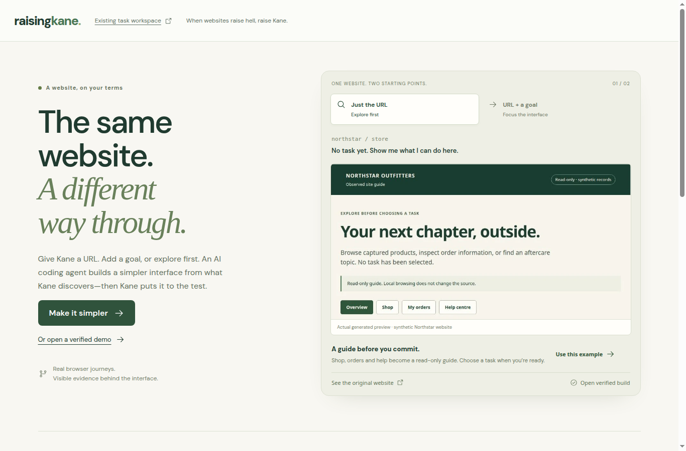

> **Current implementation:** the default entry is the Explore-driven interface builder.
> Start with [builder implementation and run instructions](docs/raising-kane/builder-implementation.md).
> It uses `gpt-6.1-sol`, actual Kane screenshots and a sandboxed generated React interface.
> URL-only input stays an overview; intent is optional. Only the two configured synthetic
> websites are supported. The earlier prebuilt workflows remain at `/?legacy=1`.

# Raising Kane

**When websites raise hell, raise Kane**



The [Explore-driven interface builder](docs/raising-kane/explore-driven-builder-plan.md)
implements URL → Explore → generated React → verification and repair. The
[implementation record](docs/raising-kane/builder-implementation.md) separates implemented
scope from ongoing browser verification. The source workflows below also remain directly
available through the earlier interface at `/?legacy=1`.

A calm interface for getting a difficult website task done without losing your choices.
Kane operates the source website during the user's workflow, checks its review against
saved preferences, and verifies the resulting confirmation. The app blocks submission
until that review passes and the user approves the exact proposal.

Two working, clearly labeled sandboxes ship together:

- **Northstar Outfitters:** return the red shoes, keep the jacket, choose a return
  reason and refund destination, and get a persistent return receipt with a demo QR.
  Changing to printer-free drop-off exposes a source-site trap: it resets the refund
  to store credit. Kane catches the mismatch; a correction and the same validator
  must pass before approval.
- **Linden Home:** move a service visit to Saturday morning while keeping the same
  technician and avoiding an extra fee. Compare three actual source slots, approve
  a verified choice, and get a saved appointment confirmation. Losing availability
  invalidates approval; the existing booking remains until a valid move commits.

The sites are synthetic. This is a supported-integration demonstration, not arbitrary
website automation, a real merchant return, or a real appointment service.

## Run locally

Use Node 24 (tested), Chrome, an authenticated Kane account with credits,
and the checked CLI release:

```bash
npm ci
npm install -g @testmuai/kane-cli@0.10.0-rc.3
npx @testmuai/kane-cli-skill
kane-cli login --oauth
npm run check:kane
npm run dev
```

Open **http://127.0.0.1:5173**. The source sites run on ports **5174** and **5175**.
Set `PORT` to change the app port; sources default to the next two ports. All three
servers bind to loopback. Use `npm run dev` for the complete application;
`npm run preview` serves only the built frontend and cannot run workflows.

Copy `.env.example` to ignored `.env` and set `OPENAI_API_KEY` to enable the runtime
builder (`gpt-6.1-sol`). Generation has no mock fallback. The older task workspace
can still use its explicitly labeled sample intent parser without a key. Browser
operations in either path use real Kane jobs. Never commit credentials.

Task records, source records, approval grants and browser profiles persist under
ignored `data/`. Keep this directory to resume receipts after restart. This is a
single-process local demo; it is not a hosted multi-tenant service.
Tasks created by the older PoC without an owner session remain read-only in this
build. Start a new task to exercise the completed workflow; existing records are
not deleted or silently adopted by another browser.

## Experience and demo

Use **Demo now** to open a recorded verified generated interface immediately. Its capture
date and unchanged-artifact status remain explicit; new user tasks run Kane live. See the
[short demo runbook](DEMO.md). Fresh generation still requires the server API key.


Enter a supported URL, optionally describe a task, and choose **Explore & simplify**.
Blank intent produces a strictly read-only site overview. Choosing a supported task
starts a separate focused build; supplying an intent initially goes directly to focused
discovery and generation. Northstar now starts at `/store`, with product/category links,
order details, delivery tracking and separate returns/warranty paths.
Inspect source captures and evidence-linked decisions while the builder works. Only
a candidate that passes its Kane journey and saved-source check gets **Use my interface**.
The generated interface then operates through the same trusted source controller:

Choose a supported task → make choices → watch the current Kane
step → resolve any mismatch → approve exact terms → send → receive verified proof.
The generated frame supplies choices and review; the trusted host supplies approval,
submission and the saved receipt. The build workspace retains source screenshots,
interface decisions, failed candidates and passing checks. User sessions remain owner-bound;
separate unguessable test sessions operate only on the synthetic sites.

Repairs reuse captured discovery. Unchanged verification requirements reuse Kane's saved
journey and recordings, while every candidate gets a fresh synthetic transaction. Replay
counts come from Kane's results; the first build still requires discovery and authoring.

The [earlier product and demo guide](docs/raising-kane/implementation-and-demo.md)
and [verification report](docs/raising-kane/verification.md) describe the prebuilt workflows and distinguish real runtime
jobs, UI checks, deterministic tests and historical PoC evidence.

## Check the implementation

```bash
npm test
npm run build
# With the app running and Kane authenticated:
npm run verify:kane
```

`npm test` covers source-owned approval, stale revisions, duplicate prevention,
availability changes, mandatory extracted fields and recovery after a commit timeout.
These are contract tests; some inject a worker double and are not Kane evidence.

Requirements are in `requirements/raising-kane-completion.md`. Kane assurance generated
three `_test.md` checks under `.testmuai/tests/`. Their variables are deliberately blank:
complete real tasks first and supply their actual URLs, using Kane's object format:

```json
{
  "return_receipt_url": { "value": "http://127.0.0.1:5173/?taskId=YOUR_RETURN_ID", "secret": false },
  "appointment_receipt_url": { "value": "http://127.0.0.1:5173/?taskId=YOUR_APPOINTMENT_ID", "secret": false },
  "start_url": { "value": "http://127.0.0.1:5173", "secret": false }
}
```

```bash
kane-cli testmd run .testmuai/tests/inspect-and-reload-the-completed-synthetic-return-receipt_test.md --agent --headless --variables-file /path/to/local-variables.json
```

Do not run multiple standalone `testmd` processes against the default Chrome port.
The product uses its own task browser profiles and serializes Kane jobs. Local assurance
was used for this build; derived criteria remain unapproved, so this is not a claim of
human-approved assurance coverage. See the [field guide](kane-field-guide.md) before
using shared-project assurance or Explore.

## Architecture and boundaries

Kane Explore and bounded branch observations → OpenAI coding agent → compiled React
interface → Kane verification/repair → published interface. During use: generated React
frame → trusted host → Node task controller → Kane CLI → separate source website.
The controller stores intent, checks typed browser observations against source records,
and manages recovery. Each source atomically consumes a grant bound to the exact
proposal, draft revision and operation ID. Repeated delivery of the same operation
returns its original result. After an uncertain submission the app looks up that
operation before retrying. A successful click alone never produces a completed receipt.

Approval enforcement depends on these cooperating source adapters. Browser instructions
alone cannot provide atomic transactions on arbitrary third-party websites. Source
JSON writes are atomic within this one server process, not a distributed database.
The demo's records are readable locally; session checks protect actions, not tenant privacy.

## Further documentation

- [Project specification](docs/raising-kane/raising-kane-project-brief.md)
- [Implementation and live demo](docs/raising-kane/implementation-and-demo.md)
- [Evidence and verification](docs/raising-kane/verification.md)
- [Kane CLI field guide](kane-field-guide.md)
- [Research packet index](docs/raising-kane/README.md)
- [Historical PoC audit](docs/raising-kane/poc-review-and-build-priorities.md)
- [Earlier CLI experiments](docs/kane-validation/report.md)
- [Current review bundle](docs/raising-kane-current-review.zip)
